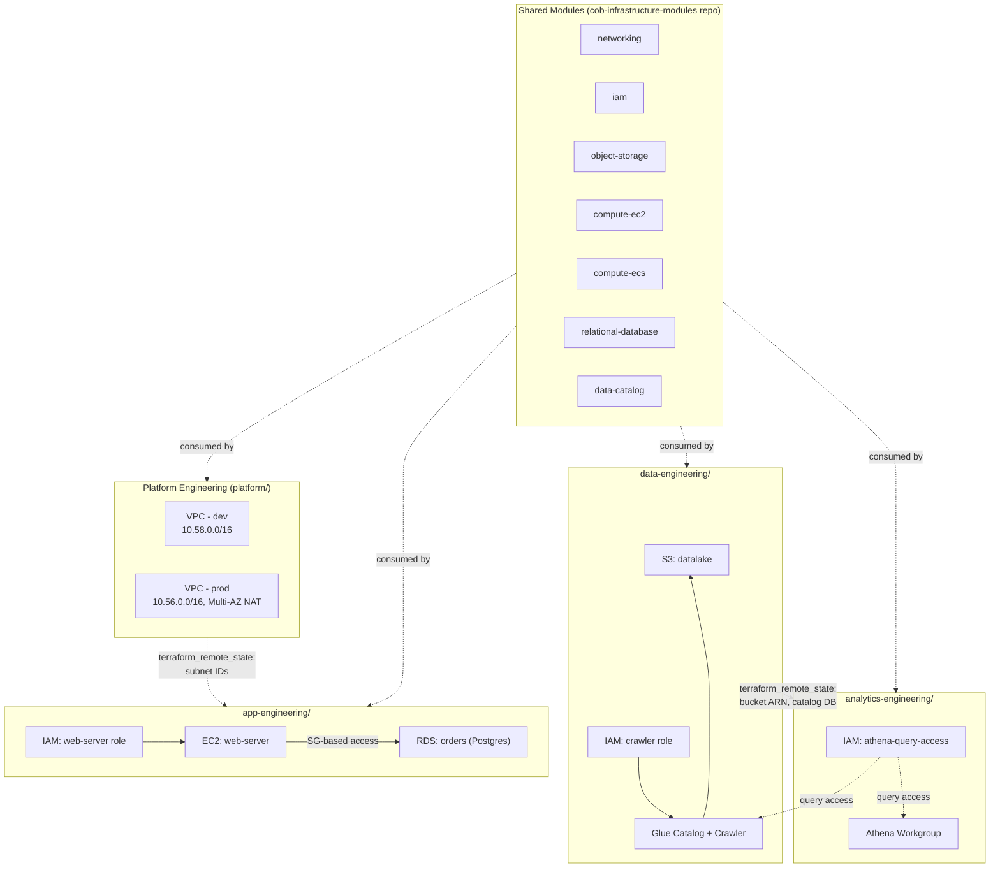

# COB Architecture

## What COB is

COB is Beejan Technologies' internal Terraform platform for provisioning
standardised AWS infrastructure. Instead of every team hand-rolling their
own VPCs, IAM roles, and databases, teams compose reusable modules
maintained centrally by Platform Engineering.

## The problem it solves

Before COB, every infrastructure request went through Platform Engineering
manually, or teams wrote their own Terraform with inconsistent security,
naming, and tagging. COB moves teams from *"can Platform Engineering build
this for us?"* to *"we provision it ourselves using the standard platform."*

## High-level architecture

## Capabilities

| Capability | Module | Notes |
|---|---|---|
| Networking | `modules/networking` | Owned solely by Platform Engineering. VPC, public/private subnets, optional NAT (prod-only redundancy) |
| Identity & Access | `modules/iam` | Workload identity only (roles), not human users - see [ADR 05](decisions/05-iam-module-scoped-to-workload-identity.md) |
| Object Storage | `modules/object-storage` | Encrypted, versioned, public access always blocked |
| Compute (EC2) | `modules/compute-ec2` | Web servers, bastions |
| Compute (ECS) | `modules/compute-ecs` | Fargate microservices |
| Relational Database | `modules/relational-database` | Auto-generated credentials via Secrets Manager |
| Data Catalog | `modules/data-catalog` | Glue crawler + Athena workgroup over an S3 bucket |

## State isolation

One S3 bucket (`beejan-cob-terraform-state`) holds every team's state,
separated by key path - one state file per team per environment (8 total),
locked via a shared DynamoDB table. See [ADR 06](decisions/06-state-file-consolidation.md).

## Cross-team data sharing

Teams never share Terraform code directly - they read each other's published
outputs via `terraform_remote_state`, pointed at the exporting team's state
file key. This is how app-engineering gets platform's subnet IDs, and how
analytics-engineering gets data-engineering's bucket and catalog details.

## Environments

`dev` and `prod` are separate, non-overlapping-CIDR VPCs per environment,
not shared subnets inside one VPC - see the isolation reasoning in this
repo's decision log.

## Security considerations

- All storage encrypted at rest (S3: KMS, RDS: native encryption)
- All public access blocked on every S3 bucket, unconditionally
- Database access controlled by security group membership, never IP ranges
- Database credentials never touch a human or Terraform plan output - generated
  and stored in Secrets Manager directly
- Prod-specific hardening (Multi-AZ, `prevent_destroy`, final snapshots) applied
  at the leaf level, not hardcoded into modules

## Known limitations

See `docs/decisions/backlog.md` for the full list. Most significant:
- No CI/CD automation (explicitly out of scope for this phase)
- No ALB integration for compute-ecs
- No team-level AWS permission boundaries yet (who can `apply` what) - see
  [ADR 05](decisions/05-iam-module-scoped-to-workload-identity.md) and
  the Multi-Layered Security section of the original brief