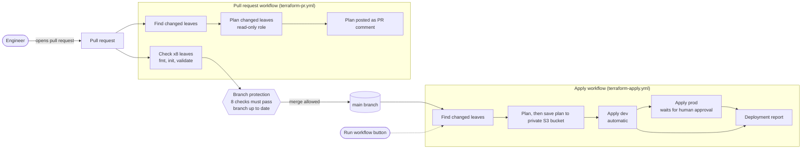
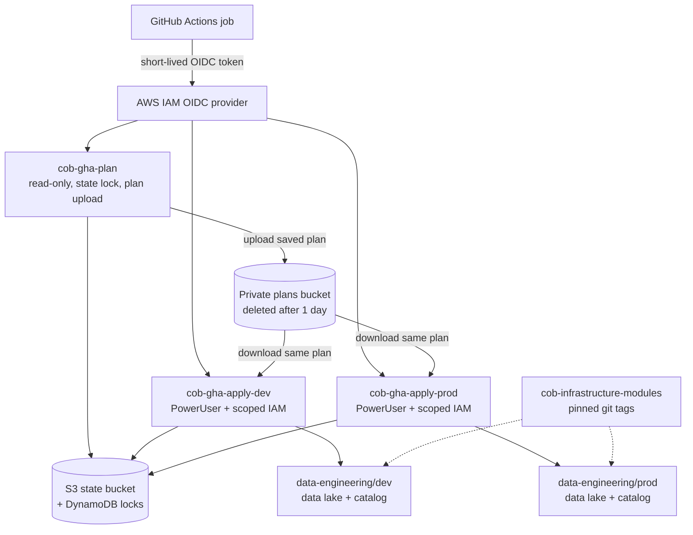

# Architecture

This project has two repositories and one AWS account.

| Repository | Role | Contents |
|---|---|---|
| `cob-infrastructure-modules` | The platform (COB). Reusable building blocks. | 7 Terraform modules, released with semantic version tags (`v1.0.0`, `v1.0.1`, `v1.0.2`). |
| `cob-infrastructure-live` | The consumer. Real deployments and the CI/CD pipeline. | `platform/{dev,prod}`, `teams/{analytics,app,data}-engineering/{dev,prod}`, `bootstrap/`, `.github/workflows/`. |

Each deployable folder (a "leaf") has its own Terraform state file. There are 8 leaves. The data platform for this assignment is `teams/data-engineering/{dev,prod}`: an S3 data lake plus a Glue catalog, crawler and Athena workgroup, all built from COB modules (`object-storage` and `data-catalog`) pinned to `v1.0.2`.

## 1. Change flow: from pull request to deployment

## 2. Identity, state and modules

## 3. What each piece does

**Pull request workflow** (`terraform-pr.yml`, runs on every PR to `main`)
- `Check <leaf>` (8 jobs): `terraform fmt -check`, `init -backend=false`, `validate`. No AWS access needed.
- `Find changed leaves`: compares the PR to `main` and lists which leaves changed.
- `Plan <leaf>`: runs a real `terraform plan` for changed leaves only, using the read-only role, and posts the plan as a PR comment for review.

**Apply workflow** (`terraform-apply.yml`, runs on push to `main` or by hand)
- Finds changed leaves, plans each one with the read-only role, and saves the plan file to a private S3 bucket under the commit SHA.
- `dev` leaves are applied automatically using the `dev` environment and role.
- `prod` leaves wait for a required reviewer, then are applied using the `prod` environment and role.
- Each apply downloads and applies the **saved plan**, so what was reviewed is exactly what runs. If the state changed in between, Terraform refuses the stale plan.
- A final report job writes the result and turns the run red if anything failed.

**Access without stored keys (OIDC)**
GitHub gives each job a short-lived signed token. AWS checks who is asking (repository, branch or environment) against each role's trust policy and returns temporary credentials. There are no AWS keys stored in GitHub.

| Role | Who can assume it | Permissions |
|---|---|---|
| `cob-gha-plan` | Pull requests and `main` | ReadOnlyAccess, state lock table access, upload to the plans bucket, read database secrets |
| `cob-gha-apply-dev` | Only jobs in the `dev` environment | PowerUserAccess plus scoped IAM for workload roles; cannot modify the three CI roles |
| `cob-gha-apply-prod` | Only jobs in the `prod` environment | Same as dev, separate role |

**Guardrails on `main`**
- All 8 `Check` jobs must pass, and the branch must be up to date.
- Administrators are included. Force pushes and branch deletion are off.
- Environments `dev` and `prod` only accept deployments from `main`. `prod` requires a named reviewer.
- Concurrency groups queue runs per leaf so two deployments never fight over one state file.

**Bootstrap stacks** (`bootstrap/`) create the OIDC provider, the roles and the plans bucket. They are applied by hand and never by the pipeline, because a pipeline must not be able to change its own permissions.
