# Pipeline demonstration

This folder shows the pipeline working on the real data platform (`teams/data-engineering`), built from COB modules. Each section names its screenshots and explains what they prove.

## Guardrails in place before the demo

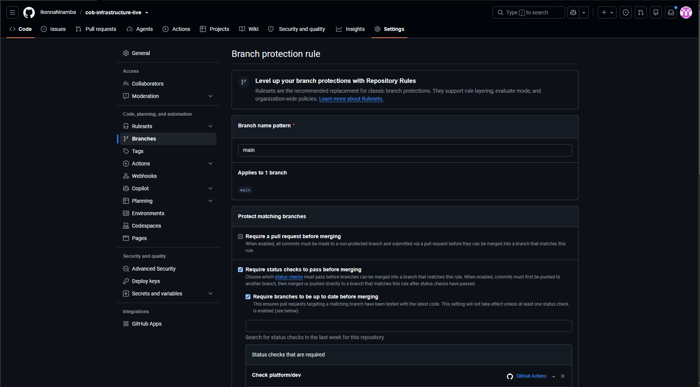

The rule on `main`, read back through the GitHub API: the 8 `Check` jobs are required, the branch must be up to date, the rule applies to administrators, and force pushes and deletions are off. It is verified through the API because saving the web form can silently overwrite it.

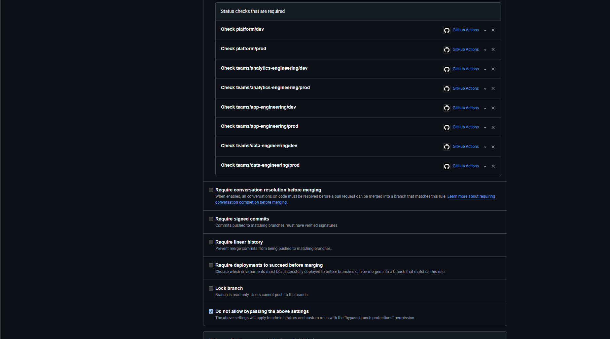

The same rule as it appears in the repository settings.

## Scenario A: a valid change, reviewed, approved and applied

**The change:** both data-engineering leaves move from COB modules `v1.0.1` to `v1.0.2`. The earlier version failed to plan because generated names overflowed AWS length limits for the long team name. The fix was made in the platform (the modules repository), released as a new tag, and adopted here.

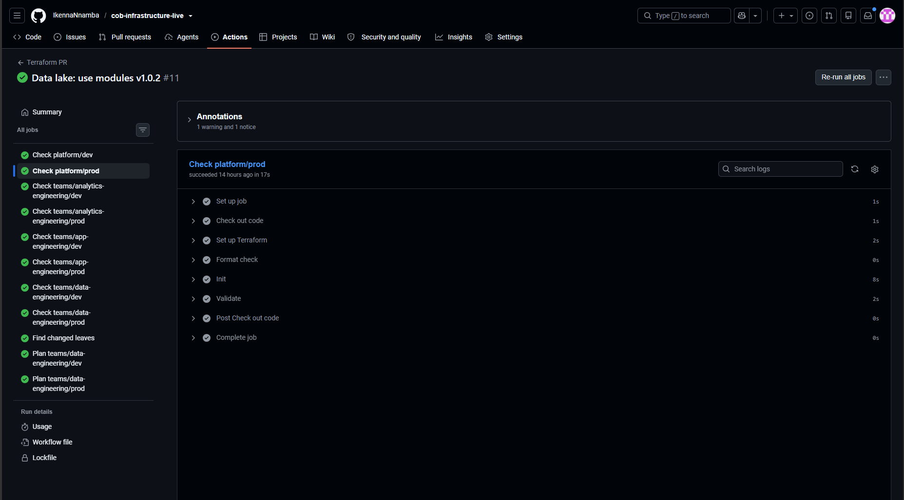

All 8 format and validation checks pass, and the plan job runs for the two leaves that changed.

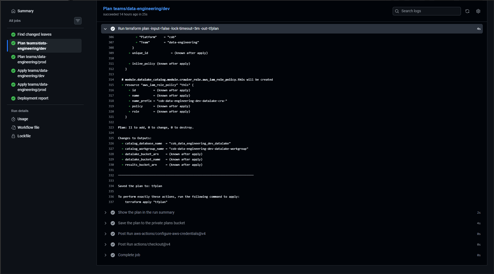

The reviewer sees exactly what will happen before anything is applied: 11 resources to add, 0 to change, 0 to destroy, for each of `dev` and `prod`. Sensitive values are hidden in the readable plan.

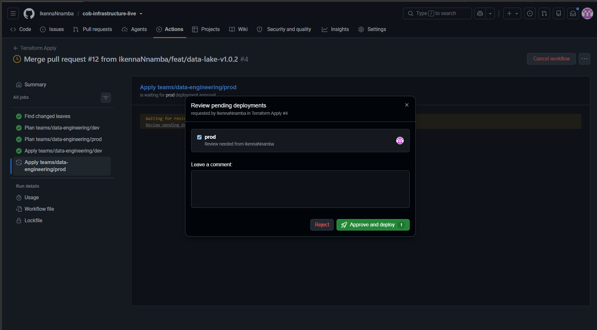

After the merge, `dev` applied automatically. The `prod` job stopped at **Review deployments** and waited for a named reviewer.

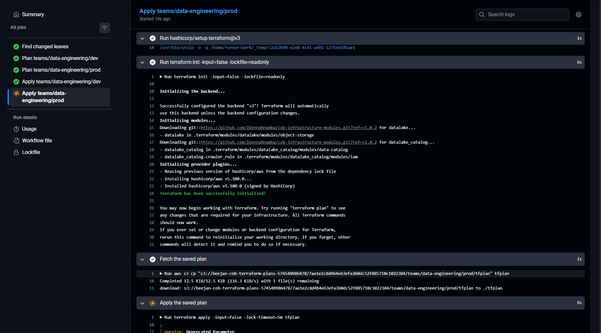

Detect, plan, apply `dev`, apply `prod` and the deployment report all succeeded. Each apply used the plan that was saved during the plan step, not a new one.

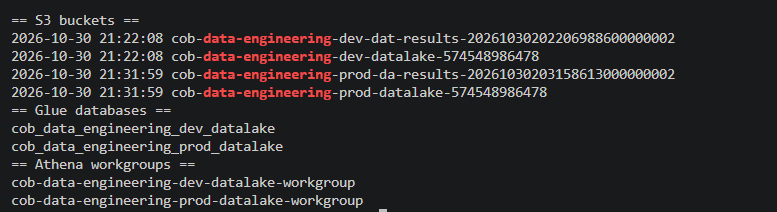

The AWS CLI confirms the data lake buckets, Glue databases and Athena workgroups exist for both environments. The results bucket names show the shortened prefix from the `v1.0.2` fix.

## Scenario B: invalid Terraform is stopped

**The change:** a deliberately broken output (`module.datalake.does_not_exist`) on a separate branch.

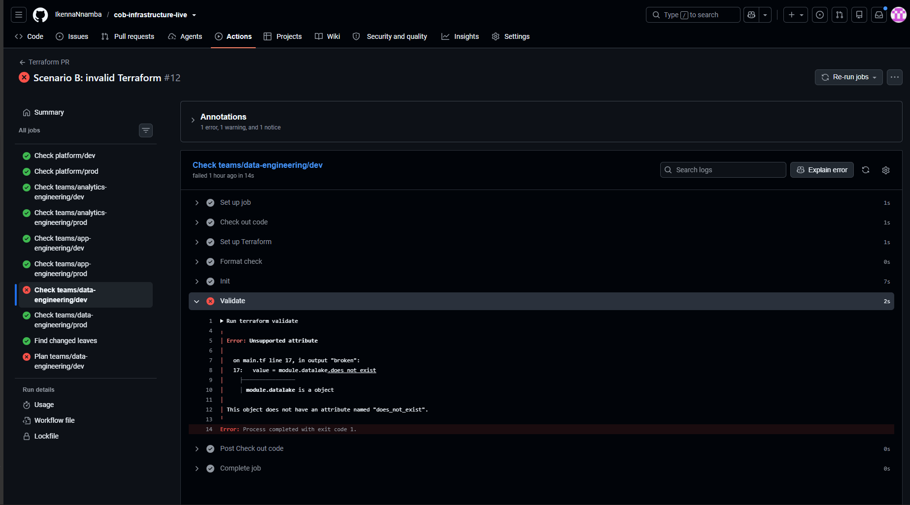

Format check and init pass. `terraform validate` fails with `Unsupported attribute`, naming the file, the line and the reason. The plan job for the same leaf also fails, and the other seven leaves stay green because nothing else changed.

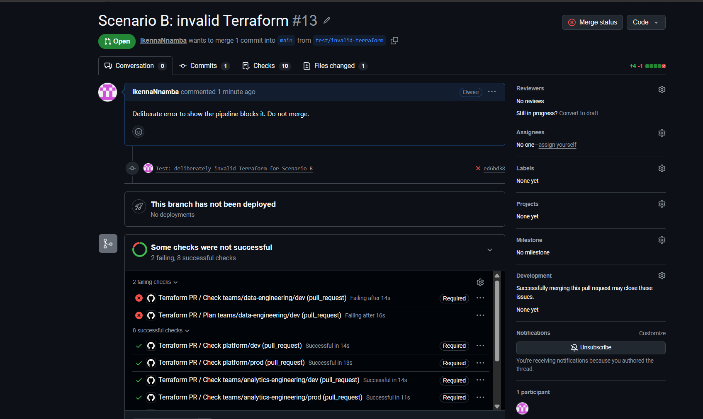

The required check is red, so the merge is refused. The change never reaches `main` and nothing is deployed.

## Scenario C: repeatability with no changes

The workflow was run by hand on an unchanged leaf (`gh workflow run terraform-apply.yml -f leaf=teams/data-engineering/dev`).

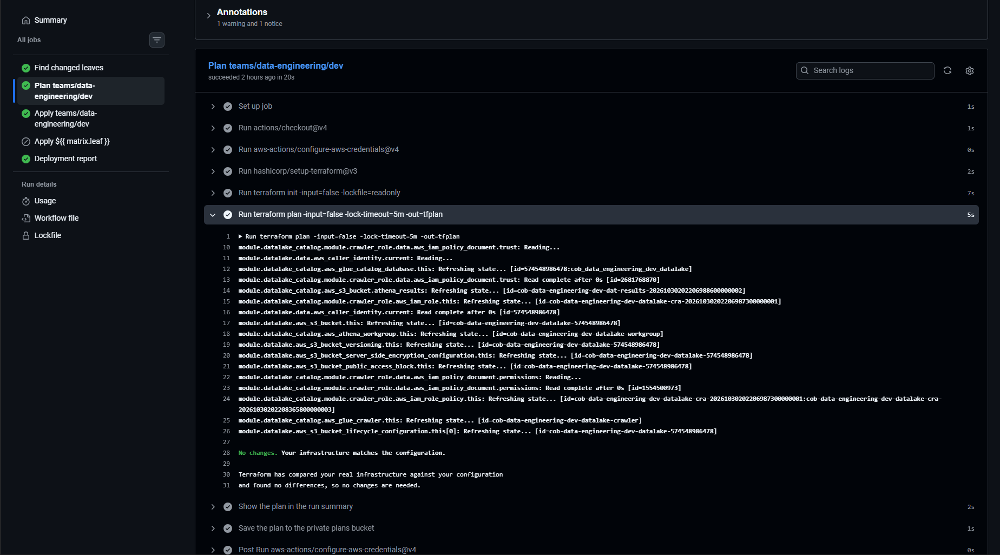

The plan reports `No changes. Your infrastructure matches the configuration.`

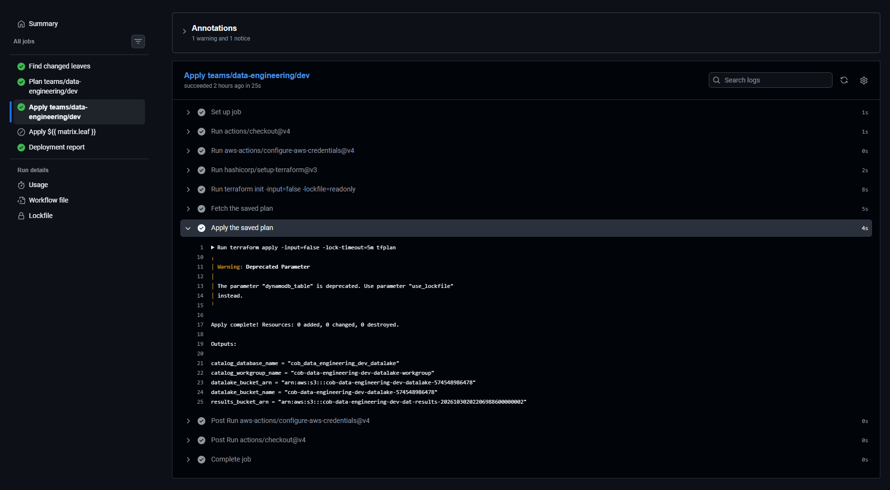

The apply step runs the empty plan and finishes with `0 added, 0 changed, 0 destroyed`. Running the pipeline again on an unchanged environment is safe.

<!-- Remove this comment marker and the closing one below once images/12-reviewer-approval.png has been added.

## Second-person review

A change approved by someone other than its author through the `prod` environment gate.

-->

## Related documents

- [Architecture](../architecture.md)
- [Using the pipeline](../pipeline-usage.md)
- [Engineering decisions and lessons](../decisions/engineering-decisions.md)