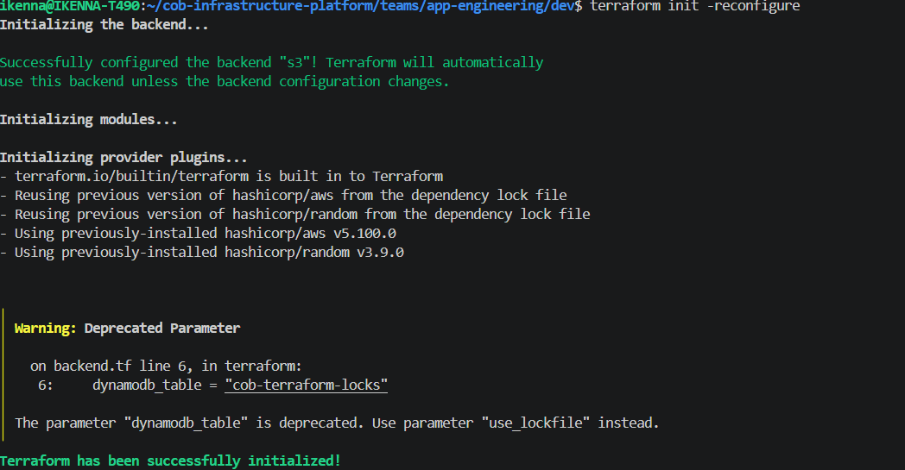
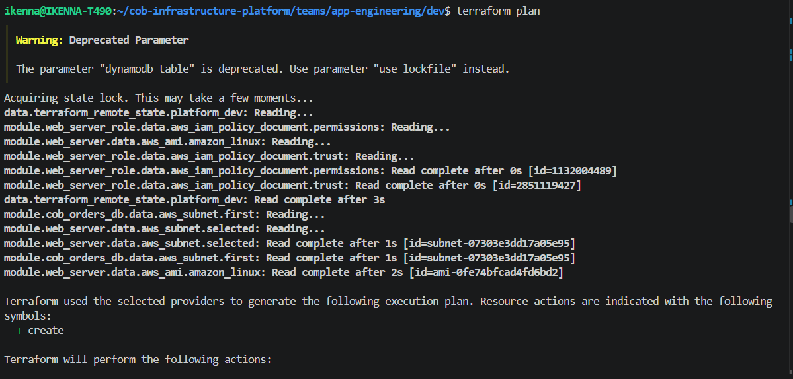
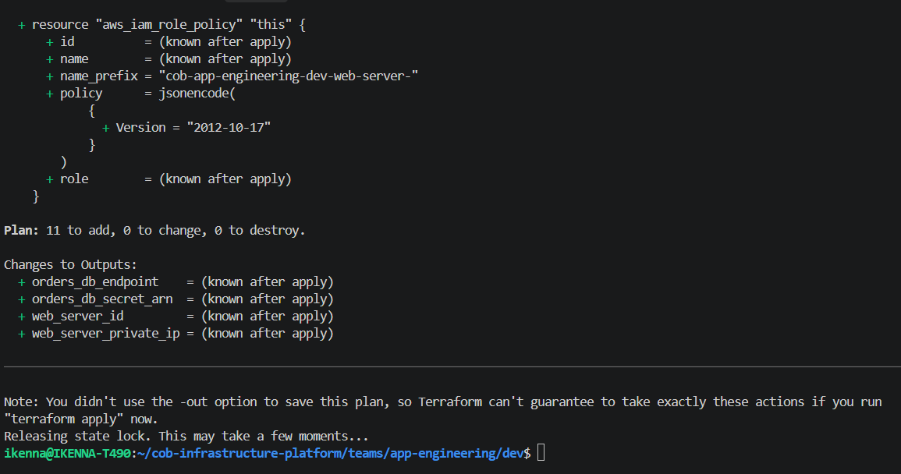

# Example: App Engineering Web Service

Demonstrates COB's core promise: a team composing multiple shared modules
together, with real cross-team data sharing - not touching a raw AWS
resource directly anywhere in their own code.

The working code lives in [`teams/app-engineering/dev`](../../teams/app-engineering/dev),
not duplicated here. This file documents what it does and how it was verified.

## What's being composed

Three module calls, chained together entirely through Terraform references:

1. **`modules/iam`** (`web_server_role`) - a role for the web server, trusted
   by `ec2.amazonaws.com`
2. **`modules/compute-ec2`** (`web_server`) - the web server itself, placed
   into a subnet it never created, using a role it never defined
3. **`modules/relational-database`** (`cob_orders_db`) - an RDS database
   whose security group only accepts traffic from the web server's security
   group specifically - not a CIDR range, not a whole subnet

## Cross-team data sharing in action

`app-engineering` never creates a VPC or subnet. Instead:

```hcl
data "terraform_remote_state" "platform_dev" {
  backend = "s3"
  config = {
    bucket = "beejan-cob-terraform-state"
    key    = "platform/dev/terraform.tfstate"
    region = "us-east-1"
  }
}
```

This reads `platform/dev`'s published state file directly - the same
environment proven live in
[`examples/platform-network-dev`](../platform-network-dev/README.md) - and
resolves `platform_dev`'s real subnet and VPC IDs at plan time
(`subnet-07303e3dd17a05e95`, `vpc-05d8bf097fe099b41` in the run below).

## Verified with terraform init and plan



```bash
terraform plan
```

Ran clean against real AWS credentials, with `platform/dev` live at the time
so the remote state read resolved to actual values rather than placeholders:




**Plan: 11 to add, 0 to change, 0 to destroy** - every resource across all
three modules planned successfully with no errors: the IAM role and policy,
the EC2 instance with its security group and instance profile, and the full
RDS stack (subnet group, security group, generated password, Secrets Manager
secret, and the database instance itself).

A few things worth pointing out directly in this output:
- The RDS security group's ingress rule shows `security_groups = (known after
  apply)` referencing the web server's SG - the membership-based access
  control described in
  [the relational-database module docs](../../docs/modules/relational-database.md)
  resolving correctly.
- `root_block_device { encrypted = true }` on the EC2 instance confirms the
  secure-by-default encryption is actually applied, not just present in code.

## Known issue found by this test

The web server's IAM role policy plans with `policy = jsonencode({ Version =
"2012-10-17" })` and no `Statement` key, because this instance was given an
empty `policy_statements = []` (it doesn't need any AWS permissions yet).
**This is expected to fail at `apply`**, since AWS requires at least one
statement in a policy document - `plan` doesn't catch this, only `apply`
would. This is a known gap in the `iam` module (no minimum-length validation
on `policy_statements`), tracked in `docs/decisions/backlog.md`, not a bug
introduced by this leaf.

## Live apply/destroy

Not yet performed for this leaf as of this writing (requires `platform/dev`
to be applied simultaneously, plus real RDS provisioning time) - the `plan`
above is the current verification. A full apply/destroy cycle is a planned
follow-up.

## What this proves

No `aws_vpc`, `aws_iam_role`, or `aws_db_instance` resource appears anywhere
in `teams/app-engineering/dev/main.tf` - every piece of infrastructure is
composed from `modules/`, wired together by referencing outputs, exactly as
COB is meant to work.