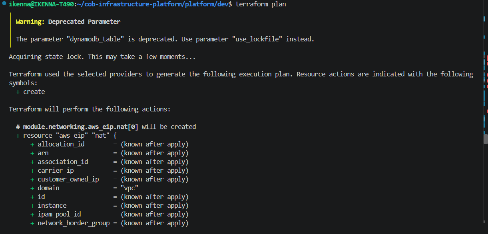
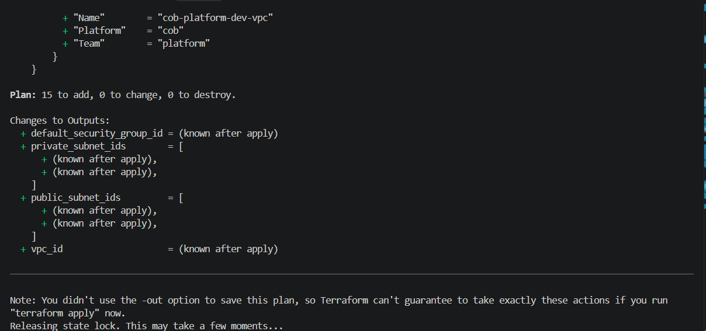
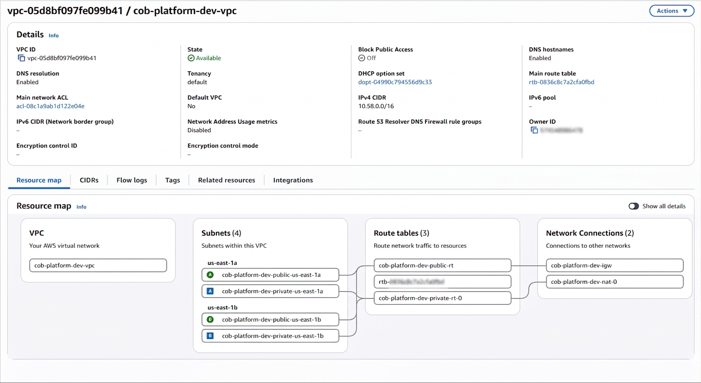
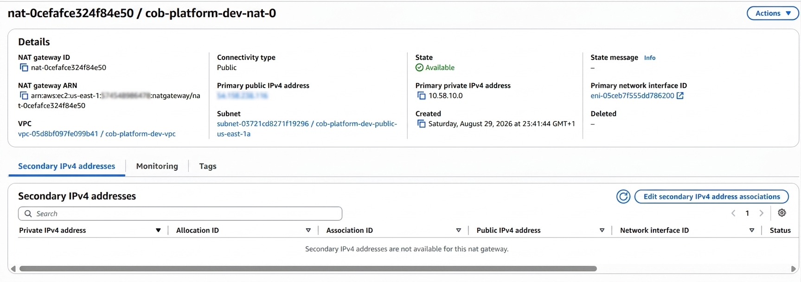

# Example: Platform Networking - Dev

Live, tested proof that `modules/networking` works end-to-end against real
AWS - not just a `plan` that looks right on paper.

## What this is

The `platform/dev` leaf calls `modules/networking` once, producing a VPC
with public/private subnets across 2 AZs, a NAT gateway, and route tables -
exactly as documented in [`docs/modules/networking.md`](../../docs/modules/networking.md).

## Terraform plan

Two consecutive plans, taken while iterating on the module:

**15 resources planned**, not 16 - this reflects a fix made after an earlier
test run: the private route table logic was consolidated to create one
shared route table in single-NAT mode instead of two identical ones. See
[the route table discussion in the decision log](../../docs/decisions/03-nat-gateway-redundancy-prod-only.md)
for the reasoning behind single vs. multi-NAT mode.

## Applied - live in AWS

`terraform apply` completed successfully. The VPC resource map confirms
exactly what was planned: 1 VPC (`10.58.0.0/16`), 4 subnets across
`us-east-1a`/`us-east-1b` (2 public, 2 private), 3 route tables, and an
Internet Gateway + NAT Gateway connection.

The NAT gateway, live and available, sitting in the public subnet as designed
(private subnets route through it, not the other way around):

*Account ID and public IP redacted from screenshots before publishing.*

## Torn down after verification

Once confirmed working, `terraform destroy` was run immediately after to
stop NAT gateway billing - this environment is not left running between tests.

## Why this matters

This is the same test flow used to validate the module in the first place -
not a curated demo. If you clone this repo and run the same commands in
`platform/dev` yourself, this is exactly what you should see.